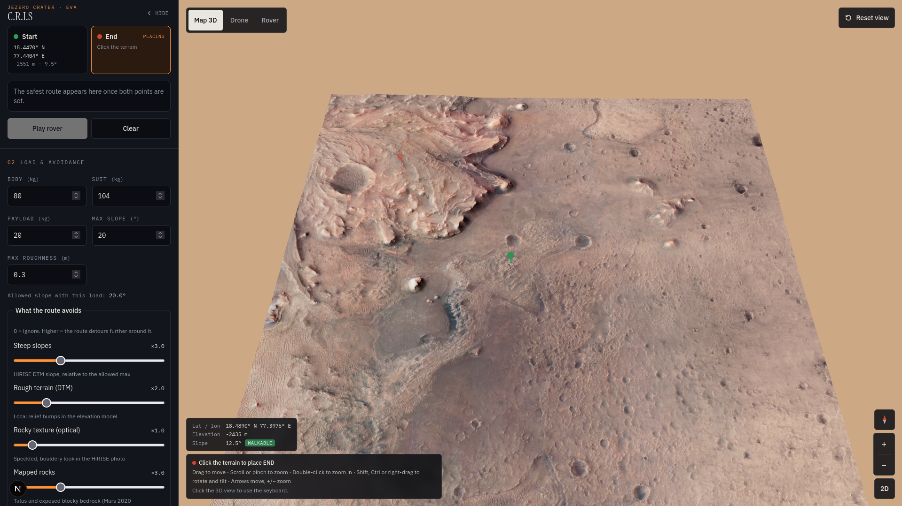

}}

# C.R.I.S

**A 3D EVA route planner for Jezero crater, Mars.**
Built for the NASA Space Apps Challenge 2026, challenge *Interplanetary Survival Guide: Martian Map*.

<p align="center">
  
</p>

## Overview

C.R.I.S (Center Reconnaissance Interplanetary Survival) helps mission teams plan walking routes for astronauts on the surface of Jezero crater, the site of the Perseverance rover's landing. The app shows a 10 × 10 km area around the Octavia E. Butler landing site in 3D. As the camera moves closer, it loads 1 km HiRISE detail tiles, so users can inspect the terrain up close. Each route is checked against NASA limits for slope and step height.

## Team

- **Team Owner:** Back Althaus, Luan Henrique (khy4n_rezz)
- **Members:**
  - Insaurralde Niven, Juan Manue (kazu)
  - Back Althaus, Luan Henrique (khy4n_rezz)
  - Borba Rodriguez, Pablo Jeremias (JeBz)
  - Campusano Rinaldo, Daniel Mathias (Kaiser)
  - Flick Zarza, Hernán Ezequiel (Gigabix)
  - Ruiz Diaz Gonzalez, Marcos Andres (Tanxv)

## Demo

- **Slides:** [drive.google.com/drive/folders/1tJeI-4hkSigZBauFm4LxRAol7lNBC77f?usp=sharing](https://drive.google.com/drive/folders/1tJeI-4hkSigZBauFm4LxRAol7lNBC77f?usp=sharing)
- **Live app:** [c-r-i-s.vercel.app](https://c-r-i-s.vercel.app)
- **Final project:** [github.com/LuanAlthaus/C.R.I.S](https://github.com/LuanAlthaus/C.R.I.S)



## Objectives

- Build a 3D planner that shows the Jezero crater terrain around the Octavia E. Butler landing site.
- Load higher-detail terrain as the user zooms in, so the area can be inspected up close.
- Check planned walking routes against NASA slope and step-height limits.
- Use open NASA data for every terrain and context layer, and cite each source.

## Achievements

- Built the 3D terrain viewer for the Jezero crater area, running in the browser.
- Implemented the tile loader that brings in 1 km HiRISE detail as the camera moves closer.
- Built the data pipeline that turns NASA terrain data into hazard layers (slope, roughness, sky-view factor).
- Integrated the Bevy simulation into the web app through WebAssembly.
- Connected NASA context data: InSight weather, DONKI space weather, MODIS temperature, and Perseverance waypoints.

## Features

- 3D terrain of a 10 × 10 km area built from HiRISE elevation and imagery.
- Detail tiles that load as the user zooms in.
- Hazard layers: slope, terrain roughness, optical texture, sky-view factor, and rock cover (talus and exposed bedrock).
- Route checks against NASA-STD-3001 and the Artemis EVA slope limit.
- Context layers: InSight weather, space weather from DONKI, MODIS surface temperature, and Perseverance waypoints.

## How it works

1. A Python pipeline (`notebooks/jezero_pipeline.py`) processes the NASA terrain data into tiles and hazard layers.
2. A simulation written in Bevy (Rust) is compiled to WebAssembly and runs inside the web app.
3. The web app streams the tiles, displays the terrain, and checks planned routes against the safety limits.

[TEAM TO CONFIRM: describe the exact route-planning steps the app performs.]

## Tech stack

- **Web app:** Next.js 16, React, TypeScript, Vercel
- **Simulation:** Bevy, compiled to WebAssembly
- **Data pipeline:** Python (earthaccess, xarray, astropy)

## NASA data

| Dataset                                          | Source                                                    | Use in C.R.I.S                        |
| ------------------------------------------------ | --------------------------------------------------------- | ------------------------------------- |
| HiRISE DTM and orthomosaic                       | NASA/JPL/University of Arizona/USGS, via JPL Mars Trek    | Terrain elevation and surface imagery |
| Mars 2020 HiRISE RGB + CTX basemap               | NASA/JPL-Caltech/University of Arizona, via mars.nasa.gov | Terrain colour                        |
| Mars 2020 photogeologic map (Stack et al., 2020) | Space Science Reviews 216:127, CC BY 4.0                  | Rock cover layer                      |
| USGS SIM 3464 geologic map (Sun & Stack, 2020)   | USGS                                                      | Geology context                       |
| THEMIS day/night IR mosaics                      | NASA/JPL/ASU, via Mars Trek                               | Thermal context                       |
| Perseverance waypoints                           | NASA/JPL-Caltech, via mars.nasa.gov                       | Reference points                      |
| InSight weather                                  | NASA, via api.nasa.gov                                    | Environmental context                 |
| DONKI WSA-Enlil                                  | NASA CCMC, via api.nasa.gov                               | Space weather                         |
| MODIS Terra/Aqua LST                             | NASA GIBS/Worldview                                       | Surface temperature                   |
| Perseverance raw images                          | NASA/JPL-Caltech                                          | Reference imagery                     |
| Safety limits                                    | NASA-STD-3001; Artemis EVA-EXP-0042 Rev B; ICES-2025-294  | Slope and step-height thresholds      |

The full list with licenses is in `docs/SI_USAGE.md` and the credits section.

## Getting started

```bash
pnpm install
cp .env.example .env.local
pnpm dev                     # http://localhost:3000
```

To rebuild the terrain data and the simulation:

```bash
python notebooks/jezero_pipeline.py <stage>
bash scripts/build-sim.sh
```

## Use of Super Intelligence (SI)

Claude (Anthropic), used through the omp coding agent, helped write the data pipeline, the Bevy simulation, the web bridge and API routes, the build script, and the user interface. The team defined the plan, the terrain features, and the safety logic. The hazard training labels in `notebooks/labels/jezero_patches.csv` were made by hand. Details are in `docs/SI_USAGE.md`.

## Limitations

- **Outdated imagery.** The terrain uses orbital imagery that may not show recent surface changes.
- **Hardware limits.** The machine we had could not load the full map at once, so the app loads only parts of it.
- **Time limit.** The project was built in 48 hours, which limited the features we could finish and test.

## Next steps

- **Update the imagery.** Replace the orbital data with more recent surface images so the map reflects the current terrain.
- **Load the full map.** Optimize how the terrain tiles are streamed and cached, so the complete 10 × 10 km area runs on modest hardware.
- **Test the routes.** Compare the planned routes with real Perseverance traverses to check the safety limits.
- **Extend the time.** With more than 48 hours, add the features that were left out and test them properly.

## License

MIT. See [LICENSE](LICENSE). Third-party components keep their own licenses, listed in `.claude/skills/_licenses/`.

C.R.I.S is a community project. It is not affiliated with or endorsed by NASA. The Perseverance rover model is from NASA 3D Resources, with NASA and JPL logos removed.
