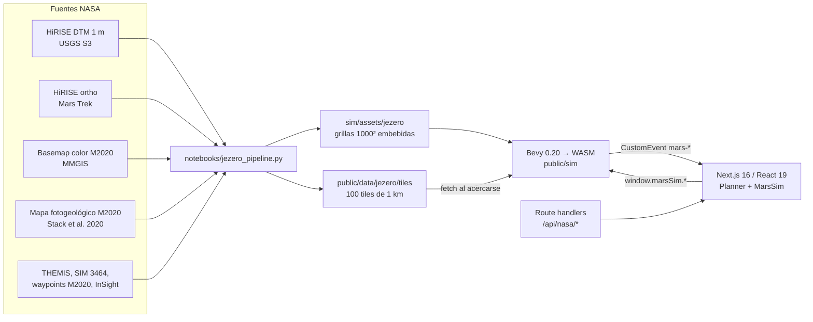

# C.R.I.S — documentación del proyecto

Proyecto del equipo para el NASA Space Apps Challenge 2026, challenge 10 **"Interplanetary Survival Guide: Martian Map"** (`docs/challenges/10-martian-map.md`). Es un planificador 3D de caminatas EVA (persona con traje espacial) y de rutas de rover sobre 10 × 10 km del cráter Jezero, alrededor del sitio de aterrizaje Octavia E. Butler (18,4447° N, 77,4508° E).

- **La idea es del equipo.** La IA ("Super Intelligence", SI) escribió código e investigó fuentes a partir de ese plan. El registro está en `docs/SI_USAGE.md`, y las notas de traspaso entre sesiones en `docs/kaz/handoff.md`.
- **Datos:** solo NASA y socios. Las fuentes se citan en la UI, en `meta.json` y en el README.
- **Sin logos de NASA/JPL** en la app: el modelo del rover que se sirve tiene los logos tapados.

## Arquitectura



## Datos y fuentes

| Capa | Fuente | Uso |
|---|---|---|
| Elevación | HiRISE DTM mosaic 1 m (NASA/JPL/UArizona/USGS), `mosaic/mars2020_trn` en S3 de USGS | Terreno 3D (malla de 40 m de lejos, tiles de 4 m de cerca), pendiente y rugosidad |
| Foto | HiRISE orthomosaic (Mars Trek, z16 ≈ 0,64 m/px) | Textura del terreno (detalle en gris) y textura óptica |
| Color | Basemap HiRISE RGB + CTX de Mars 2020 (NASA/JPL-Caltech/UArizona, MMGIS) | Croma del terreno. Cubre el 79,8 % de la caja; el resto se completa con una tabla gris→croma |
| Rocas | Mapa fotogeológico del Mars 2020 Science Team (Stack et al. 2020, doi:10.1007/s11214-020-00739-x) | Talud y roca madre "blocky" expuesta: fracción por celda de 10 m |
| Geología | USGS SIM 3464 (Sun & Stack 2020) | Capa de unidades geológicas |
| Térmica | THEMIS IR día/noche (NASA/JPL/ASU, Mars Trek) | Amplitud térmica relativa |
| Radiación | Factor de cielo visible derivado del DTM | Proxy de exposición (no es una dosis) |
| Recorrido | Waypoints de Perseverance (mars.nasa.gov MMGIS) | Capa opcional y vínculo con las imágenes crudas |
| Condiciones | InSight (api.nasa.gov), DONKI WSA-Enlil, MODIS LST (GIBS) | Tarjetas de condiciones y comparación con la Tierra |
| Imágenes | Feed de imágenes crudas de Perseverance (mars.nasa.gov) | Galería por sol |
| Rover 3D | Perseverance, NASA 3D Resources (`25042_Perseverance.glb`) | `public/data/jezero/rover.glb`, sin logos |
| Etiquetas de peligro | Mapa geológico in situ de Perseverance (Crumpler et al. 2023, doi:10.1029/2022JE007444, Zenodo 7545299, CC BY 4.0) y trazado de los drives de Perseverance (`M20_traverse.json`, NASA/JPL-Caltech) | Reglas de `autolabel` |

No existe un mapa oficial publicado de abundancia de rocas ni de CFA para esta zona: JPL no lo publicó, y el de THEMIS de alta resolución sale en 2027. Tampoco funciona más la API Mars Rover Photos de api.nasa.gov (archivada en 2025-10).

### Pipeline (`notebooks/jezero_pipeline.py`)

Se ejecuta desde la raíz con `python notebooks/jezero_pipeline.py <etapa>` (`.venv` o `uv run --with ...`):

| Etapa | Qué hace |
|---|---|
| `selftest` | Pruebas de geometría y tiles |
| `terrain` | DTM → altura, pendiente (p90), rugosidad (p90 del residuo de relieve a 2 m), textura óptica, geología, alturas de los tiles. Al final corre `color` |
| `color` | Ortho a color: el gris de HiRISE × el croma del basemap de Mars 2020 (`ortho.jpg` y 100 `o_*.jpg`) |
| `rocks` | `rocks.png` a partir del mapa fotogeológico |
| `traverse` | Waypoints de Perseverance dentro de la caja |
| `labels` | Hojas para que el equipo etiquete parches a mano (`jezero_patches.csv`) |
| `autolabel` | Etiquetas por reglas a partir de datos de NASA para cada parche de 48 m. Escribe `jezero_patches_nasa.csv` con la regla que puso cada etiqueta. Gana la última regla que coincide: <br>• **seguro:** Perseverance pasó por el parche, o la mitad del parche o más es superficie lisa (Stack 2020). <br>• **rugoso:** la mitad o más es talud, roca en bloques expuesta o dunas grandes (Stack 2020), o regolito grueso/mixto o float-lag in situ (Crumpler 2023), o hay un bloque de eyección mapeado. <br>• **intransitable:** pendiente p90 ≥ 20° (límite de EVA de NASA), o la mitad o más son ripples in situ (JPL: evitar ripples ≥ 10 cm) |
| `hazard` | Clasificador MLP. Usa las etiquetas del equipo si hay 150 o más; si no, las de `autolabel`, balanceadas. Valida con 20 de los 100 tiles de 1 km apartados; resultado actual: 93,1 % |
| `radiation`, `thermal` | Factor de cielo visible, índice THEMIS y `conditions.json` |

Los datos crudos van a `data/raw/jezero/` (ignorado por git) y los intermedios a `data/processed/jezero/`.

## Simulación (Rust + Bevy 0.20.1 → WASM, `sim/`)

| Módulo | Responsabilidad |
|---|---|
| `lib.rs` | App de Bevy: plugins y ventana sobre `#mars-canvas` |
| `data.rs` | `Site`: grillas embebidas con `include_bytes!` (altura, pendiente, rugosidad, textura, rocas, peligro, térmica, radiación, geología, ortho RGB). `VScale` arranca en 1 (relieve real) |
| `terrain.rs` | 10×10 chunks de 1 km con LOD: malla gruesa 26² y tile de detalle 251² que se descarga al acercarse. `Surface` guarda las alturas de la malla dibujada, y sobre ella se apoyan el rover, la cámara y los clics. Texturas con mipmaps y anisotropía 16 |
| `route.rs` | A* (crate `pathfinding`) sobre la grilla de 10 m, con límites duros y costos ponderados (ver abajo). Tests unitarios |
| `layers.rs` | Capas de datos recompuestas en la CPU: slope, rough, texture, rocks, hazard, thermal, radiation, geology, cost |
| `camera.rs` | Tres modos. **Mapa** estilo Google Maps: arrastre con inercia, zoom hacia el cursor, doble clic, rotar e inclinar, brújula, vista 2D. **Dron**: cámara libre. **Rover**: cámara de seguimiento |
| `picking.rs` | Mouse y táctil: clic contra arrastre, doble clic, gestos de dos dedos, inicio y fin de ruta sobre `Surface` |
| `rover.rs` | GLB de Perseverance a escala real. Su pose sale de 4 contactos de rueda y sigue la ruta |
| `bridge.rs` | Exports `wasm_bindgen` y eventos `CustomEvent` |
| `input.rs` | Atajos nativos: teclas 1–0 para las capas, F1–F3 para las cámaras |

### Planificador de rutas

Costo de entrar a una celda (`CostGrid::multiplier`):

$$c = 1 + w_s\left(\frac{s}{s_{eff}}\right)^2 + w_r\frac{r}{r_{max}} + w_t\,t + w_{rocks}\,k + w_h\,h + w_\theta\,\theta + w_{rad}\,q$$

- **Bloqueo duro:**
  - pendiente $s \ge s_{eff}$;
  - rugosidad $r > r_{max}$;
  - peligro = 255.
- **$s_{eff}$:** es 20° dividido por el factor de carga $(m_{cuerpo}+m_{traje}+m_{carga})\,g_{Marte} / (m_{cuerpo}\,g_{Tierra})$ cuando ese factor es mayor que 1. Los 20° son el límite EVA de Artemis de NASA (EVA-EXP-0042 Rev B). NASA no tiene un valor para Marte.
- **$r_{max}$:** 0,30 m por defecto, la altura de paso con traje que probó NASA (ICES-2025-294). Queda por debajo del obstáculo de 40 cm de Perseverance. Se puede editar en la UI.
- **Pesos por defecto:** pendiente 3, rugosidad 2, textura 1, rocas 3, peligro 5, térmica 0,5 y radiación 0,5. Todos se editan en el panel. Cuáles unidades cuentan como roca y los márgenes son decisiones del equipo.
- **Diagonales:** A* no las corta junto a celdas bloqueadas.

**Verificación de seguridad** (12 pares reales de 1,5 km o más):
- Ninguna ruta segura supera los límites. La rugosidad máxima fue de 0,10 a 0,24 m.
- Comparadas con la ruta más corta, las rocas en la ruta bajan del 16 % al 0 % y del 32 % al 2 %.
- La pendiente máxima baja; por ejemplo, de 19,5° a 5,5°.
- A cambio, las rutas son entre 0 y 8 % más largas.

## Web (Next.js 16, `src/`)

- `src/components/MarsSim.tsx` carga `public/sim/boot.js` y el WASM, y monta el canvas.
- `src/components/Planner.tsx` es el panel: guarda el estado de la UI y lo vuelve a enviar al sim cuando llega `mars-sim-ready`. Contiene estas secciones de `src/components/planner/`:
  - `RouteSection`: inicio y fin, resultado y perfil;
  - `LimitsSection`: carga, pendiente máxima, rugosidad máxima y pesos;
  - `LayersSection`: capas, leyendas y exageración vertical;
  - `ConditionsSection`;
  - `RawImagesSection`;
  - `MapOverlay`: modos de cámara, brújula, +/− y 2D/3D;
  - `SourcesFooter`.
- `src/lib/marsSim.ts` es el contrato TS del sim: tipos `RouteParams`, `Overlay`, eventos y leyendas.
  - Métodos: `set_overlay`, `set_camera_mode`, `set_params`, `play_route`, `clear_route`, `set_pick_target`, `set_vertical_scale`, `set_show_traverse`, `reset_view`, `map_zoom`, `map_north`, `map_top_down`.
  - Eventos: `mars-sim-ready`, `mars-pick`, `mars-pick-target`, `mars-route`, `mars-hover`, `mars-tiles`, `mars-camera`, `mars-rover-stopped`.
- Route handlers en `src/app/api/nasa/`: `apod`, `donki-mars` y `raw-images`. Agregan caché y protegen la key del lado del servidor.

## Cómo correrlo

```bash
corepack pnpm install
corepack pnpm dev                      # http://localhost:3000
source ~/.cargo/env && bash scripts/build-sim.sh   # recompilar el WASM (~6 min de wasm-opt)
(cd sim && cargo test --lib)           # tests del planificador y del terreno
corepack pnpm lint && corepack pnpm build
```

- Toolchain: Rust 1.97.1 con target `wasm32-unknown-unknown` y `wasm-bindgen-cli 0.2.130`.
- No corras `pnpm build` y el build de Rust a la vez: la máquina se queda sin memoria.
- El WASM compilado se commitea porque Vercel no tiene Rust.

## Prompts utilizados

Estos son los prompts del equipo al agente (Claude Code / omp), en orden y textuales. La hora es local (−03). No se incluyen los comandos `/effort` ni `/compact`.

1. **12:23**: "/plan nuestro tema es el mapa de marte, utiliza los agentes haiku para darte ideas sobre las implementaciones que podriamos hacer, las que tenemos hasta ahora son estas Posibles datos a utilizar: Opticos //inicial, Atmosfericos //3ra, Termicos //3ra, Geofisicos //inicial, Radiacion //2da imp. Idea verificar caminos seguros junto a si es posible pasar por ahi debido a su temperatura o condiciones fisicas ya sean cuevas, huecos o algun terreno deforme, junto a esto llegar a determinar si el clima es bueno para realizar la exploracion y comparar los datos con los de la tierra para poder determinar si un ser humano podria aguantar en las condiciones halladas con los trajes espaciales, crear una ruta y ver como podria afectar la movibilidad los suministros y equipos que llevan. Idea: Evitar obstaculos rocosos, lugares con mucha temperatura y con mucha radiacion, crear un camino seguro por el cual la persona podra transitar tranquilamente o sin muchos problemas esto se hara con una interfaz grafica la cual permitira visualziar el camino, similar a google maps. Ideas exprimentales: utilizar mapas dinamicos y una red neuronal para analizar los caminos, verifica si es posible crear un modelo de reconocimiento, utilizaremos bevy como motor grafico y tenemos pensado hacer una simulacion 3D del robot y una camara libre mediante la simulacion de un dron, el mapa sera en 3D y basate en el texto que te pase para delimitar los parametros utilizados, lee el archivo correspondiente al tema y utiliza las fuentes de la nasa, tienes acceso a la api y estas webs [Mars Trek, USGS Astrogeology interactive maps, science.nasa.gov (Curiosity's proposed path), NASA Worldview, Mars 2020 raw images], unicamente basate en las fuentes pasadas y en tus reglas globales, tambien quiero que me crees en canva mediante el mcp una interfaz grafica utilizando el agente global creado llamado agentdesing o algo asi, lee tus reglas globales para la orquestacion y utiliza haiku para investigarcion, lectura y research, pasale todo a opus al terminar para que de el veredicto"
2. **13:37**: "recuerda que cada una hora debes actualizar en handoff con isntrucciones para retomar y abrir otra sesion nueva automaticamente, otra cosa que debes hacer es compactar cada 270k de tokens"
3. **14:25**: "en vez de solo 2km me gustaria tener mas lugar para visitar y recuerda que las rutas se deben basar en los datos obtenidos ya sean opticos, geologicos,termicos, etc, mejora el modelo del rover a este [imagen adjunta], otra cosa es que la interfaz sea mas intuitiva y el modo de dron sea literalmente una vista como la del rover pero con camara libre, mejora la capacidad de seleccionar el punto de inicio y final debido a que lo noto tosco, dime para que sirve el dato de las imagewnes que esta en la interfaz, ve algunas cosas por mejorar y intenta renderizar el mapa en 3D, para lo del lugar de visualizar con mas lugar necesito qeu vaya cargando a medida de que se acerque la persona para asi optimizar"
4. **14:32**: "recuerda el handoff cada hora con sesion en claude.md y que lo retome, dime ahora tu avance y que estas haciendo, recuerda anotar todo en docs o en issues de github que se llaman kaz/"
5. **14:36**: "estas cambiando tambien el modelo del rover que te pedi o aun no?"
6. **14:37**: "ya paso una hora, termina eso del modelo y crea la sesion automaticamente y continua con el handoff"
7. **14:44**: "continua en otra sesion con el handoff"
8. **14:46**: "te falta terminar con los subagentes_"
9. **14:53**: "pq al poner npm run dev se crashea y se cierra, ya puedo crear la nueva sesion?"
10. **15:01–15:02**: "ya puedo ?" / "puedo ir al handoff?"
11. **15:09**: "lee el handoff y continua, quiero que el disenio del rover sea totalmente igual al modelo original, hay un bug al utilizar la vista del rover que parece que no se renderizan bien las texturas y aparece debajo de ellas al moverse, otro problema entonctrado es que hay pequenias lineas azules en el terreno cuando no eliges el punto de partida y inicio, arregla esto y sigue utilizando la misma metodologia de los haikus para darte informacion, lee claude.md y handoff md y continua, utiliza subagentes haikus, el modo dron no se puede girar"
12. **15:10**: "basate en el funcionamiento de google maps, un mapa de marte real te lo estare pasando enseguida para cambiarlo"
13. **15:14**: "verifica que las trayectorias se basen en las mas seguras para el robot y humanos despues de temrinar tus tareas"
14. **15:20**: "que estas haciendo"
15. **15:22**: "el modelo del rover no es igual a el glb de los archivos, usa ese mejor para el rover"
16. **16:00**: "el render 3D esta basado en el mapa de marte de la nasa? hazlo en base a eso y que sea real en esa zona en base a las fuentes que he pasado y la api de la nada, quiero un limite se rugosidad y que entren en el calculo las rocas"
17. **16:16**: "recuerda que las fuentes son de la nasa y andamos en un hackaton"
18. **16:18**: "cambia el nombre a C.R.I.S en vez del nombre raro de jezero"
19. **16:35**: "utiliza un agente haiku para subir al repo de C.R.I.S el cual esta vinculado" y, en el formulario de confirmación: "primero crea un archivo .MD en la carpeta de docs sobre la documentacion del proyecto y prompts utilizados, basate en el handoff y el proyecto (codigo de rust, webview, etc) y luego sube en una rama nueva kaz en el remoto"
20. **16:49**: "sube al main ahora"
21. **17:12**: "la clasificacion podrias hacerla tu en base a los datos de la nasa? revisa las fuentes y intenta en una rama llamada kaz/tests" (git no permite `kaz/tests` mientras exista la rama `kaz`, por eso la rama se llama `kaz-tests`)

## Pendiente

- **Capa de peligro:** por ahora se entrena con las etiquetas por reglas de `autolabel` (rama `kaz-tests`). Si el equipo etiqueta a mano 150 parches o más en `notebooks/labels/jezero_patches.csv`, `hazard` pasa a usar esas etiquetas. Las reglas de `autolabel` también se pueden editar.
- **Decisiones del equipo:**
  - margen por debajo de 20°;
  - qué unidades geológicas cuentan como roca y con qué peso;
  - límites para el rover y para la persona.
- **Mapa real de Marte** que va a pasar el equipo: falta integrarlo en el pipeline y el terreno.
- **Entregables en inglés:** README final, slides y video de 30 s o menos.
